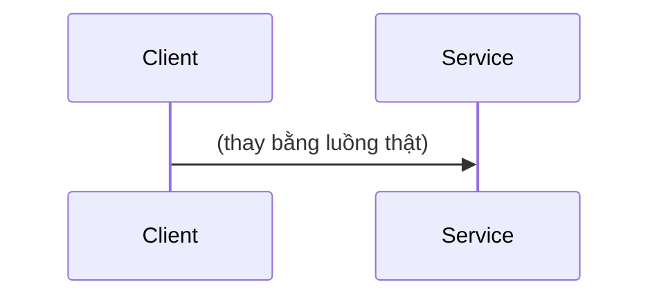

# {{TOPIC}} — Research

> Phase 1 · Cập nhật: {{DATE}}
> Đánh dấu mọi khẳng định: **[theo tài liệu + link]** / **[suy luận]**. Phase này chưa có **[đo được]**.

## 1. Vấn đề

<!-- Kỹ thuật này giải quyết vấn đề gì? Mô tả bằng một tình huống cụ thể (ví dụ: ghi DB thành công nhưng gửi Kafka thất bại).
     Không có nó thì hệ thống hỏng THẾ NÀO: mất dữ liệu, trùng lặp, sai thứ tự, latency tăng, sập dây chuyền...?
     Hỏng ở điều kiện nào (tải cao, crash, network partition)? Tần suất / mức độ nghiêm trọng thực tế. -->

## 2. Cơ chế bên trong

<!-- Phần quan trọng nhất. Giải thích TẠI SAO kỹ thuật hoạt động, đi tới tầng internals:
     cấu trúc dữ liệu, giao thức, lock, log, buffer, đảm bảo (guarantee) và giả định ngầm.
     Ít nhất một sơ đồ mermaid (sequenceDiagram cho luồng, flowchart cho thành phần, stateDiagram cho vòng đời). -->

## 3. Các cách implement

<!-- Thường 2–4 cách, LUÔN có 1 cách "ngây thơ" (naive) làm baseline để thấy vấn đề.
     Bảng tóm tắt trước, chi tiết từng cách sau. -->

| # | Cách | Ý tưởng một dòng | Vai trò |
|---|---|---|---|
| A | | | baseline (naive) |
| B | | | |

### 3.A. <tên cách>

<!-- Lặp lại khối này cho từng cách. -->

- **Nguyên lý:** <!-- tại sao cách này đúng/sai, dựa trên đảm bảo nào -->
- **Các bước implement chi tiết:**
  1. <!-- đủ chi tiết để phase 3 code theo được: bảng nào, transaction boundary ở đâu, config nào -->
- **Ưu điểm:**
- **Nhược điểm:**
- **Lỗi thường gặp và cách tránh:**
  - <!-- lỗi → hậu quả → cách tránh -->

## 4. Khi nào KHÔNG nên dùng

<!-- Điều kiện mà chi phí (độ phức tạp, latency, vận hành) lớn hơn lợi ích. Phương án đơn giản hơn thay thế. -->

## 5. Câu hỏi cần kiểm chứng bằng thí nghiệm

<!-- Mỗi câu phải đo/kiểm được và sẽ thành giả thuyết ở 03-experiment-plan.md.
     Tốt: "Polling interval 100ms làm tăng CPU của PostgreSQL bao nhiêu % so với CDC ở 1k msg/s?"
     Tệ: "Cách nào tốt hơn?" -->

| ID | Câu hỏi | Cách nghĩ sẽ trả lời (đo gì) |
|---|---|---|
| Q1 | | |

## 6. Nguồn tham khảo

<!-- Ưu tiên: tài liệu chính thức, paper gốc, source code (link tới file/dòng), engineering blog của công ty vận hành thật.
     Ghi ngày truy cập nếu là trang hay thay đổi. -->

1.
