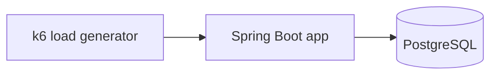

# {{TOPIC}} — System design

> Phase 2 · Cập nhật: {{DATE}}
> Mục tiêu: hệ thống NHỎ NHẤT đủ để phơi bày vấn đề ở 01-research.html §2 và so sánh công bằng các cách ở §5–6.

## 1. Domain tối giản

<!-- Chọn domain đơn giản nhất làm lộ vấn đề (đặt hàng, chuyển tiền, đếm view...).
     Vì sao domain này đủ để phơi bày vấn đề? Workload của nó trông thế nào (đọc/ghi, kích thước, phân phối key)? -->

## 2. Thành phần

<!-- Liệt kê service, DB, broker, cache... Mỗi thành phần: vai trò, image + version pin, cổng. -->

| Thành phần | Vai trò | Image / version | Cổng |
|---|---|---|---|
| | | | |



## 3. Contract chung

<!-- Interface Java và/hoặc API HTTP mà MỌI implementation đều tuân theo. Đây là điều kiện để so sánh công bằng.
     Ghi chữ ký method / endpoint, request/response, ngữ nghĩa lỗi, đảm bảo (ví dụ: at-least-once). -->

```java
// public interface ... { }
```

## 4. Cách mỗi implementation cắm vào

<!-- Spring profile hoặc biến môi trường nào chọn implementation nào. Cấu trúc module/package trong system/.
     Mỗi implementation khác nhau ở đâu, giống nhau ở đâu. -->

| Impl | Profile / env | Module / package | Khác biệt chính |
|---|---|---|---|
| A (baseline) | | | |

## 5. Schema dữ liệu

<!-- DDL (Flyway migration), Kafka topic (partition, replication, key), key Redis... Ghi lý do cho index/partition key. -->

```sql
-- CREATE TABLE ...
```

## 6. Quan sát được (observability)

<!-- Metric/log nào cần expose để đo ở phase 5 (Micrometer: timer, counter, gauge; HikariCP pool; consumer lag...).
     Cách kiểm tra tính đúng đắn dữ liệu sau kịch bản lỗi (query đếm, checksum, so sánh nguồn/đích). -->

## 7. Cố ý bỏ qua

<!-- Những gì không làm và vì sao không ảnh hưởng tới kết luận (auth, UI, retry ngoài phạm vi, multi-region...). -->

-

## 8. Nguồn tham khảo

1.
